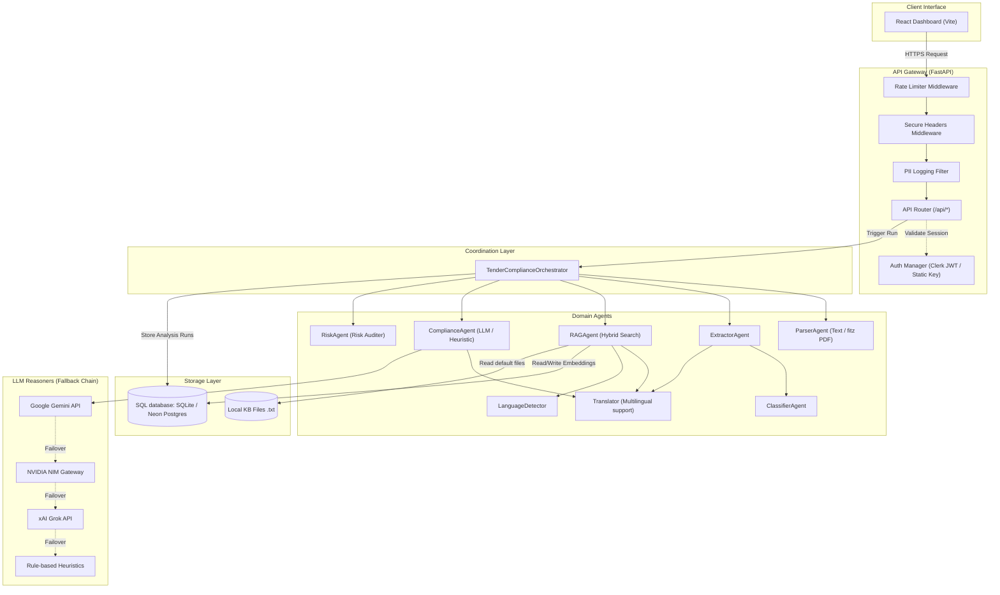
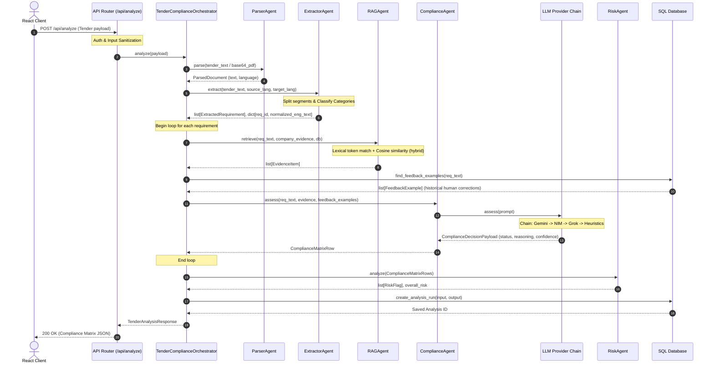

# Platform Architecture: Tender Compliance Engine

This document provides a comprehensive overview of the design patterns, system components, execution flows, and infrastructure models that power the AI Legal Intelligence Platform.

---

## 1. System Component Design

The platform is designed with a decoupled, agentic architecture consisting of an API Gateway, a coordination layer (`TenderComplianceOrchestrator`), specialized functional agents, and a dual storage layer (SQLite for development / PostgreSQL with `pgvector` for production).



---

## 2. Request Flow: Compliance Analysis Pipeline

When a client submits a tender text or PDF payload for analysis, the request flows sequentially through the agent pipeline:



---

## 3. Database Entity-Relationship (ER) Design

The system relies on five main tables to manage analyses, documents, users, feedback corrections, and vector embeddings.

```mermaid
erDiagram
    users {
        int id PK
        string user_id UK "Clerk sub ID"
        string email UK
        string full_name
        string preferred_language
        string preferred_ai_model
        datetime created_at
    }

    document_assets {
        int id PK
        string kind "tender | company | knowledge_base"
        string filename
        string content_type
        int size_bytes
        string content_hash UK
        largebinary file_bytes
        string extracted_text
        string source_language
        datetime created_at
    }

    knowledge_chunks {
        int id PK
        string content_hash UK
        string scope "global | request-id"
        string source
        string language
        string content
        string normalized_content
        vector_or_json embedding "pgvector dim 12 / JSON"
        json metadata "source_kind"
        datetime created_at
    }

    analysis_runs {
        int id PK
        string analysis_id UK
        string tender_title
        string tender_language
        string output_language
        json input_payload
        json output_payload
        datetime created_at
    }

    feedback_entries {
        int id PK
        string analysis_id FK
        string requirement_id
        string requirement_text
        string original_status
        string corrected_status
        string comments
        datetime created_at
    }

    users ||--o. document_assets : "uploads"
    analysis_runs ||--o{ feedback_entries : "has human corrections"
```

---

## 4. Deployment Topologies

The codebase supports two deployment workflows detailed below:

### Topology A: PaaS Deployment (Render + Vercel)
Ideal for staging, quick previews, and testing.

```
       [ Client Browser ]
               | (HTTPS)
               v
     +-------------------+
     |   Vercel Edge     | <--- Serves React + Vite Static Bundle (dist/)
     +-------------------+
               | (REST API Calls)
               v
     +-------------------+
     |   Render Web      | <--- Runs FastAPI Backend in Docker Container
     +-------------------+
               |
               v
     +-------------------+
     |  Render Postgres  | <--- Stores Runs, Feedback & Vector Chunks
     +-------------------+
```

### Topology B: Serverless IaC (GCP Cloud Run + Cloud SQL)
Production architecture managed using Terraform.

```
                                [ Client Browser ]
                                        | (HTTPS Gateway)
                                        v
                            +-----------------------+
                            |     Cloud Run         | <--- Serves Python App + Embedded Frontend
                            |  (Backend & Assets)   |      Scales instance count (0 - 10)
                            +-----------+-----------+
                                        |
               +------------------------+------------------------+
               | (Secure VPC Connection via Connector)           | (Fetch API Keys)
               v                                                 v
  +--------------------------+                      +--------------------------+
  |      Cloud SQL           |                      |     Secret Manager       |
  |  (PostgreSQL + pgvector) |                      | (GEMINI_API_KEY, DB_PWD) |
  +--------------------------+                      +--------------------------+
```
